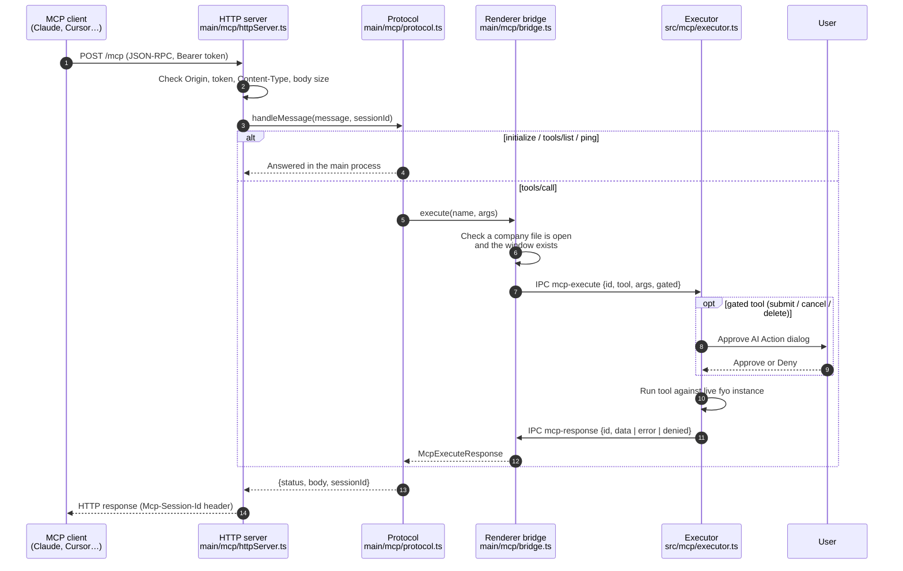

Chat-Accounting is an Electron app with two processes: the **main process** (Node.js, owns the window and the SQLite file) and the **renderer** (the Vue UI, where all accounting logic runs through the `fyo` framework). The MCP server lives in the main process, but tools execute in the renderer. This page explains why, and what happens at each hop.

## The request path



## Layer by layer

### 1. Lifecycle: `McpServerManager`

`main/mcp/index.ts` owns the server. The app constructs one manager at startup and wires it into two lifecycle events:

- **`app.on('ready')`**: after the window is created, `main.mcp.start()` runs.
- **`app.on('before-quit')`**: `main.mcp.stop()` closes the listener and rejects any in-flight calls.

On start the manager:

1. Returns early if the server is already running or the `mcpServerEnabled` setting is `false`.
2. Ensures a token exists. If `mcpServerToken` is empty it generates 32 random bytes, hex-encoded, and saves it.
3. Tries to listen on `mcpServerPort` (default `13337`). On `EADDRINUSE` or `EACCES` it tries the next port, up to 10 ports in total. Any other error, or exhausting all 10, puts the server into the `error` state with a message the settings tab displays.
4. Pushes a status update to the renderer over the `mcp-status-changed` IPC channel so the settings tab updates live.

Settings are persisted with `electron-store`, the same store the app uses for the list of recent company files.

| Setting key | Default | Meaning |
| --- | --- | --- |
| `mcpServerEnabled` | `true` | Whether to start the server on launch. |
| `mcpServerPort` | `13337` | First port to try. |
| `mcpServerToken` | generated | The bearer token. |

### 2. Transport: the HTTP server

`main/mcp/httpServer.ts` is a plain `node:http` server. It does not use the official `@modelcontextprotocol/sdk`, because the Electron 22 main process runs Node 16 and the SDK needs Node 18 or newer. Every request passes these checks in order:

| Check | Failure response |
| --- | --- |
| Path must be exactly `/mcp` | `404 Not found` |
| `Origin` header, if present, must be `localhost`, `127.0.0.1` or `::1` | `403 Forbidden origin` |
| `Authorization: Bearer <token>` must match the stored token (constant-time comparison) | `401 Unauthorized` with a `WWW-Authenticate` header |
| Method must be `POST` or `DELETE` (`GET` is refused because the server never streams) | `405 Method not allowed` |
| `Content-Type` must include `application/json` | `415` |
| Body must be at most 1 MiB | `413 Request body too large` |
| Body must parse as JSON | JSON-RPC `-32700 Parse error` |

Native MCP clients do not send an `Origin` header, so the origin check only bites on browser-based callers. That is intentional: it blocks DNS-rebinding attacks where a web page tricks your browser into calling `127.0.0.1`.

### 3. Protocol: JSON-RPC over Streamable HTTP

`main/mcp/protocol.ts` implements the subset of MCP the app needs. It is pure request-in, response-out, so it is unit-testable without Electron.

| Method | Behaviour |
| --- | --- |
| `initialize` | Negotiates the protocol version (`2025-06-18` preferred, `2025-03-26` accepted), creates a session id, returns server info and an `instructions` string that tells the assistant to call `get_company_info` first and that creates only make drafts. |
| `ping` | Returns `{}`. |
| `tools/list` | Returns the 20 tool definitions from `utils/mcp/toolDefs.ts`. Answered entirely in the main process. |
| `tools/call` | Forwards to the renderer bridge, then wraps the result as MCP `content` text. Errors and user denials come back with `isError: true` rather than as JSON-RPC errors, so the assistant can read the message and explain it. |
| `resources/list`, `prompts/list` | Return empty lists. The server exposes tools only. |
| Notifications (no `id`, or method starting `notifications/`) | `202 Accepted`, no body. |
| JSON-RPC batch arrays | Rejected with `-32600`. Batching was removed from the MCP spec in `2025-06-18`. |
| `DELETE /mcp` | Forgets the session named in `Mcp-Session-Id`. |

**Sessions** are an in-memory map of session id to last-seen time. A session expires after 60 minutes of inactivity. A request with an unknown or expired session id gets `404`, which tells spec-compliant clients to re-run `initialize`. Regenerating the token or stopping the server clears every session.

### 4. Bridge: crossing into the renderer

Accounting logic in Chat-Accounting (formulas, validation, ledger posting, number series) lives in the renderer's `fyo` instance, not in the main process. Running tools there means:

- The assistant uses exactly the same code path as a user clicking **Save** or **Submit**, so validations and ledger entries are always correct.
- The UI updates in real time. A draft invoice created by the assistant appears in the list immediately.
- There is one database connection, owned by the app, so there is no risk of two writers on the SQLite file.

`main/mcp/bridge.ts` (`RendererBridge`) does the forwarding. For each `tools/call` it:

1. Rejects unknown tool names.
2. Rejects if no company file is open (`databaseManager.db.dbPath` is empty) or the window has been destroyed, with a message that asks the user to open the company in the app.
3. Rejects if 8 calls are already in flight.
4. Creates a request `{ id, tool, args, gated }` with a random UUID, stores a resolver keyed by that id, and sends it on the `mcp-execute` IPC channel.
5. For gated tools, focuses the app window so the approval dialog is visible.
6. Starts a timeout: 30 s by default, 60 s for report and party-detail tools, 120 s for gated tools.

When the renderer answers on the `mcp-response` channel, the bridge matches the `id`, clears the timer and resolves the waiting promise.

### 5. Executor: running the tool

In the renderer, `src/mcp/registerMcpHandler.ts` subscribes to `mcp-execute` once when `App.vue` mounts. It calls `executeMcpRequest(fyo, request)` from `src/mcp/executor.ts`, which:

1. Confirms `fyo.db` is connected.
2. Looks up the implementation in the tool map (`src/mcp/tools/documents.ts`, `invoices.ts`, `masters.ts`, `reports.ts`).
3. If the request is **gated**, loads the document first so the dialog can show real values (party, date, grand total, entry type), then pushes an approval onto a reactive queue rendered by `McpConfirmationModal.vue`. The promise resolves `true` on **Approve**, `false` on **Deny** or after 115 s with no answer.
4. Runs the tool and serialises the result. Money values become plain numbers, dates become ISO strings, child tables become arrays of row objects, and attachment fields are skipped (`src/mcp/serialize.ts`).
5. Returns `{ id, data }`, `{ id, denied: true }` or `{ id, error }`. Exceptions are caught and converted to the error shape so the main process always receives a response.

The response goes back over IPC and the HTTP reply is written.

## Where each piece lives

| Path | Role |
| --- | --- |
| `main/mcp/index.ts` | `McpServerManager`: start, stop, token, port fallback, status |
| `main/mcp/httpServer.ts` | `node:http` transport, auth and origin checks |
| `main/mcp/protocol.ts` | JSON-RPC and MCP method handling, sessions |
| `main/mcp/bridge.ts` | `RendererBridge`: IPC request/response correlation, timeouts |
| `utils/mcp/toolDefs.ts` | Tool names, descriptions, JSON Schemas, gated flags, timeouts |
| `utils/mcp/types.ts` | Shared constants (port, limits) and IPC message types |
| `src/mcp/registerMcpHandler.ts` | Renderer subscription to `mcp-execute` |
| `src/mcp/executor.ts` | Dispatch, gating, error wrapping |
| `src/mcp/confirm.ts` | Approval queue |
| `src/mcp/McpConfirmationModal.vue` | The **Approve AI Action** dialog |
| `src/mcp/serialize.ts` | fyo values to JSON |
| `src/mcp/tools/*.ts` | Tool implementations |
| `src/pages/Settings/McpSettings.vue` | The **AI (MCP)** settings tab |
| `tests/testMcpTools.spec.ts` | Headless tape tests for the tool layer |

## Running the tests

The tool layer is tested without Electron against a temporary company file:

```bash
yarn test tests/testMcpTools.spec.ts
```

The suite covers schema discovery, GSTIN and HSN validation, draft invoice creation with GST, journal balancing, payments, outstanding invoice totals, and the end-to-end executor path including gating.
